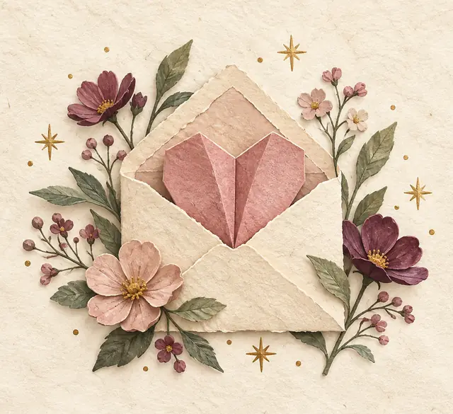

# Paper Hearts

  

[Play Paper Hearts](https://blossomz37.github.io/paper-hearts/)

A playful romance game for readers and fiction writers. Fold a paper fortune teller to discover a story spark or a fictional romantic fortune, or match characters and tropes in Matchmaker.

I created this as an experiment with **Future Fiction Academy** during **Elizabeth Ann West’s Living Writer Environment Intensive**.

Explore [Future Fiction Academy’s courses and signup options](https://future-fiction-academy.teachable.com/a/aff_7bcwdpxg/external?affcode=1654415_sfjv5x-w) (affiliate link).

— Carlo Santiago

## How to play

Choose a romance universe, relationship, and heat level. **Story spark** leaves you with an open question; **Playful fortune** offers a lighthearted romantic outcome. In **Matchmaker**, play solo or challenge one of eight rivals.

Turn on optional background music under Customize to hear a theme suited to your universe. Save favorite results in your browser, download them as text, or make a shareable postcard.

All characters are adults. All heat levels stay non-graphic. Fortunes are fictional.

## About this release

The complete app, artwork, and synthesized audio are contained in `index.html`. No installation, account, or API key is needed. You can also download that file and open it locally to play offline.

Saved results stay in your browser; download anything you want to keep.
